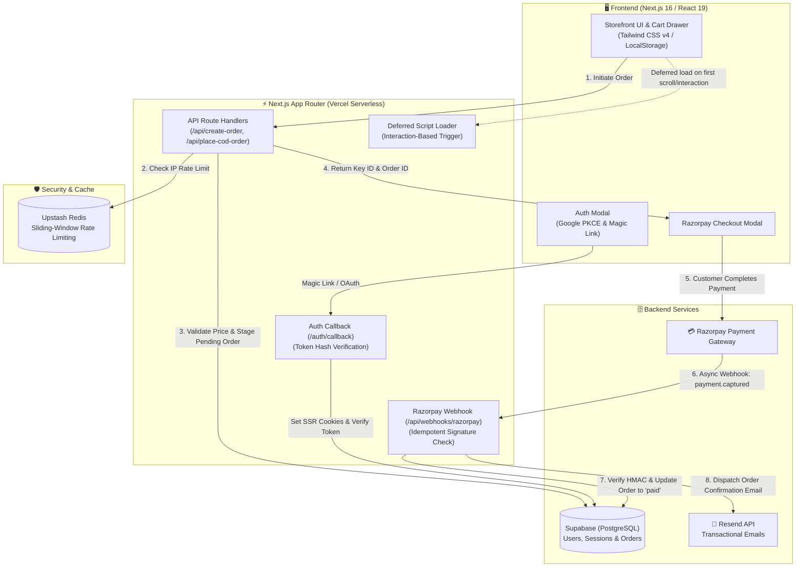

# Luwia Skin Science — Full-Stack D2C E-Commerce Platform

**🔗 Live Showcase:** [https://luwia.vercel.app](https://luwia.vercel.app)

A modern, high-performance D2C e-commerce platform engineered for a premium skincare brand. Built with Next.js 16 App Router, React 19, TypeScript, and Supabase (PostgreSQL), featuring end-to-end payment reliability, edge rate limiting, and passwordless authentication.

> **Project Background:**  
> Developed and launched as the custom storefront for Luwia Skin Science. As the brand grew and required dedicated inventory workflows, the production business was migrated to a custom-coded Shopify store (custom Liquid theme, historical customer & order data migration). This repository serves as the active, full-stack Next.js production showcase hosted on Vercel.

---

## 🚀 Tech Stack

- **Framework & UI:** Next.js 16 (App Router, Turbopack), React 19, TypeScript, Tailwind CSS v4
- **Database & Auth:** Supabase (PostgreSQL, Supabase SSR Auth)
- **Payment Processing:** Razorpay API (HMAC SHA-256 Verification, Idempotent Webhooks) + Cash on Delivery (COD)
- **Security & Rate Limiting:** Upstash Redis (Distributed Sliding-Window Edge Limiting)
- **Email & Automation:** Resend API (Transactional Order Confirmations & Magic Links)
- **Deployment:** Vercel (Edge Functions, CI/CD)

---

## ✨ Engineering Highlights

### 1. Resilient Payment Pipeline & Interrupted Session Recovery
- **Cryptographic Verification:** Every online transaction is verified on the backend via HMAC SHA-256 signatures before being finalized.
- **Pre-Payment Order Staging:** Orders are staged in Supabase with a `pending` status *before* opening the Razorpay modal. If a customer pays and immediately closes their browser, the server-side webhook catches the `payment.captured` event and updates the order automatically.
- **Idempotent Webhooks:** Webhook handlers (`/api/webhooks/razorpay`) verify the order status first, preventing double-processing or duplicate confirmation emails.
- **Zero Frontend Secret Leaks:** Razorpay public key resolution is handled via the backend order creation API (`/api/create-order`), eliminating the need for hardcoded client-side keys.

### 2. Backend Security & Price Tampering Prevention
- **Authoritative Price Validation:** Checkout endpoints (`/api/create-order` and `/api/place-cod-order`) independently recalculate line-item subtotals against the server-side product catalog, strictly rejecting any client-tampered totals.
- **Sliding-Window Rate Limiting:** Protected against spam and bot abuse using Upstash Redis on critical endpoints:
  - Checkout / Order APIs: 5 requests / min per IP
  - Magic Link Auth API: 3 requests / 5 mins per IP

### 3. Passwordless Auth & Social Sign-In (Supabase SSR)
- **PKCE OAuth:** Implemented Google OAuth with PKCE flow for secure, cookie-based session management across Server and Client Components.
- **Direct Token Hash Magic Links:** Bypasses hash fragment redirection by verifying OTP token hashes directly on our custom route handler (`/auth/callback`), ensuring server cookies are preserved seamlessly.

### 4. Performance & Core Web Vitals Optimization
- **95+ Lighthouse Score:** Leveraged static page prerendering, Next.js `<Image />` WebP/AVIF optimizations, and route prefetching.
- **Interaction-Deferred Scripts:** Architected an interaction-based script loader (`DelayedScripts.tsx`) that postpones heavy third-party tags (Meta Pixel, Clarity, GTM) until user scroll or touch, drastically reducing Total Blocking Time (TBT).
- **Environment-Isolated Analytics:** All tracking tags are fully decoupled behind optional environment variables for zero data leakage on portfolio deployments.

---

## 🏗️ System Architecture & Data Flow



<details>
<summary><b>📁 View Repository Folder Structure</b></summary>

```text
src/
├── app/
│   ├── api/
│   │   ├── auth/send-magic-link/   # Rate-limited Supabase magic link emailer
│   │   ├── create-order/           # Razorpay order generation & price validation
│   │   ├── place-cod-order/        # Cash on Delivery order processor
│   │   ├── verify-payment/         # Client-side HMAC payment signature verification
│   │   └── webhooks/razorpay/      # Idempotent safety-net webhook handler
│   ├── auth/callback/              # Supabase SSR OAuth & OTP token exchange
│   ├── checkout/                   # Frictionless checkout (Online & COD tabs)
│   ├── shop/                       # Dynamic product catalog & detail pages
│   └── order/success/              # Order confirmation & WhatsApp notifications
├── components/
│   ├── auth/                       # Google sign-in & magic link modals
│   ├── cart/                       # Slide-over cart drawer & order summary
│   ├── layout/                     # Navbar, footer, and DelayedScripts loader
│   └── product/                    # Product gallery, FAQs, and reviews
├── context/
│   ├── AuthContext.tsx             # Global user auth state
│   └── CartContext.tsx             # React Context with localStorage persistence
└── lib/
    ├── products.ts                 # Authoritative product catalog & pricing
    ├── supabase-server.ts          # Supabase Admin client (Service Role)
    ├── supabase-server-ssr.ts      # Cookie-aware SSR Supabase server client
    ├── email.ts                    # Resend email templates & dispatchers
    └── fbpixel.ts / meta-capi.ts   # Optional dual browser & CAPI conversion tracking
```

</details>

---

## 🛠️ Local Development Setup

### 1. Clone the repository
```bash
git clone https://github.com/your-username/luwia.git
cd luwia
```

### 2. Install dependencies
```bash
npm install
```

### 3. Configure Environment Variables
Create a `.env.local` file in the root directory:

```env
# Site URL
NEXT_PUBLIC_SITE_URL=http://localhost:3000

# Supabase (Auth & Database)
NEXT_PUBLIC_SUPABASE_URL=https://your-project.supabase.co
NEXT_PUBLIC_SUPABASE_ANON_KEY=your-supabase-anon-key
SUPABASE_SERVICE_ROLE_KEY=your-supabase-service-role-key

# Razorpay Payments (Test Mode)
RAZORPAY_KEY_ID=rzp_test_your_key_id
RAZORPAY_KEY_SECRET=your_razorpay_secret
RAZORPAY_WEBHOOK_SECRET=your_webhook_secret

# Resend (Transactional Emails)
RESEND_API_KEY=re_your_resend_api_key

# Upstash Redis (Rate Limiting)
UPSTASH_REDIS_REST_URL=https://your-db.upstash.io
UPSTASH_REDIS_REST_TOKEN=your_upstash_token

# Analytics (Optional - disabled by default)
# NEXT_PUBLIC_CLARITY_ID=
# NEXT_PUBLIC_GTM_ID=
# NEXT_PUBLIC_META_PIXEL_ID=
```

### 4. Run the development server
```bash
npm run dev
```

Open [http://localhost:3000](http://localhost:3000) in your browser.

---

## 🚢 Deployment

The project is optimized for deployment on **Vercel**:
1. Connect your repository to Vercel.
2. Add the environment variables above in **Project Settings → Environment Variables** (set for **Production** and **Preview**).
3. Set `NEXT_PUBLIC_SITE_URL` to `https://luwia.vercel.app`.
4. Deploy!
